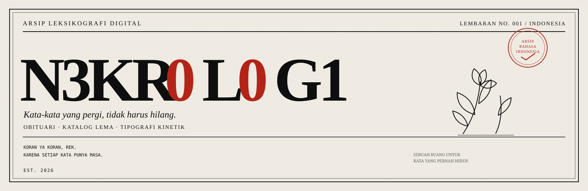
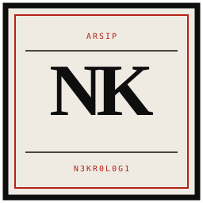
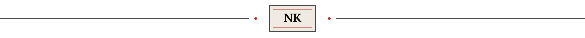
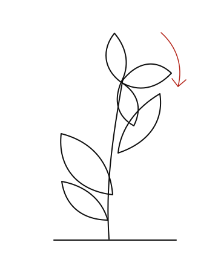
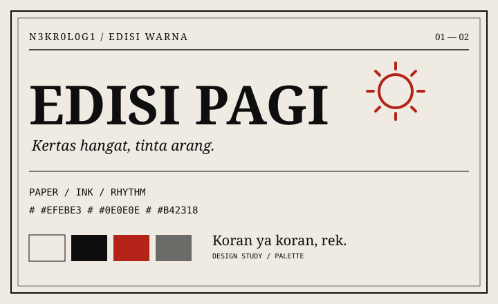
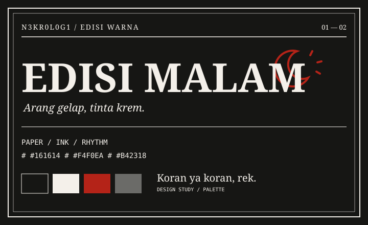
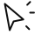
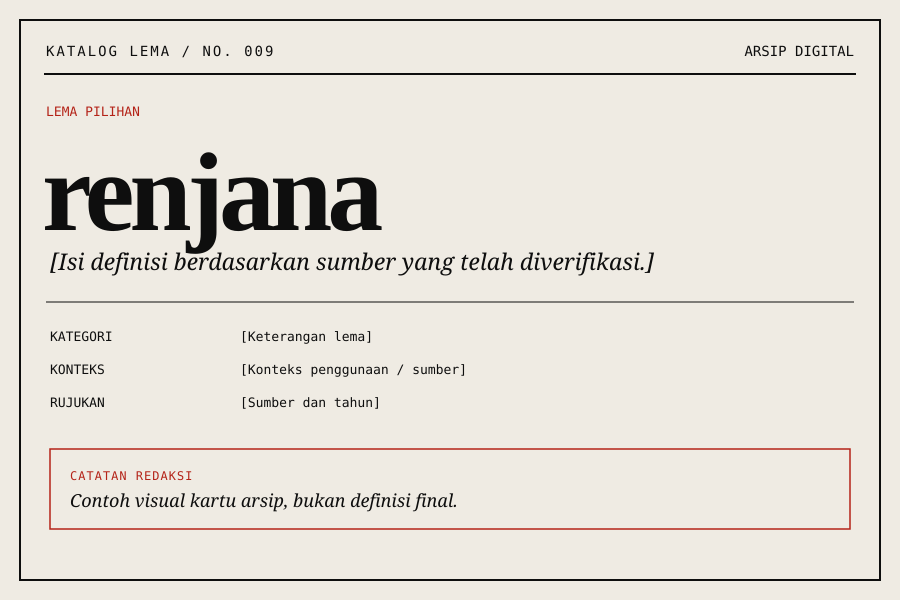
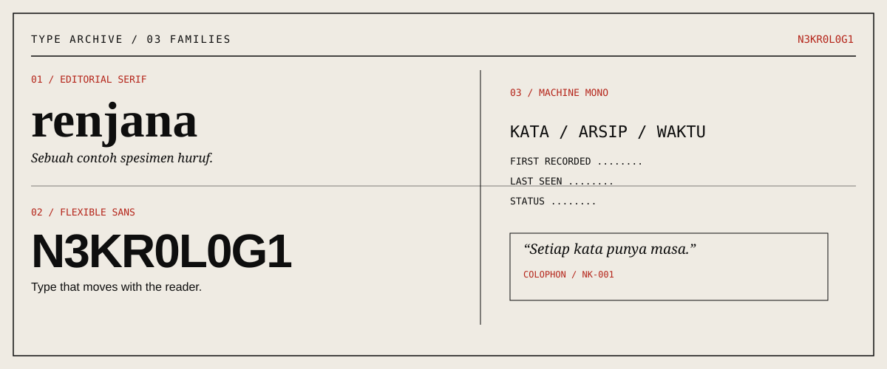
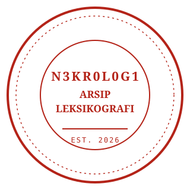

<div align="center">



<br><br>



<br>

<sub>ARSIP LEKSIKOGRAFI DIGITAL · LEMBARAN NO. 001</sub>

# N3KR0L0G1

**Kata-kata yang pergi, tidak harus hilang.**

Lembaran memorial digital untuk kata-kata bahasa Indonesia yang perlahan tersisih dari percakapan sehari-hari. Diterbitkan dalam rupa koran *broadsheet*, dengan tipografi kinetik, ruang arsip, dan sedikit rasa kehilangan.

<br>

<a href="#sebelum-lembaran-dibuka"></a>
<a href="#arsip-kata"></a>
<a href="#ruang-produksi"></a>
<a href="#cara-membuka-lembaran"></a>

</div>

---

<div align="center">

</div>

## Sebelum lembaran dibuka

Beberapa kata tidak benar-benar mati. Kita hanya berhenti memanggilnya.

N3KR0L0G1 berangkat dari ide sederhana. Kata-kata lama juga layak punya tempat untuk dikenang. Awalnya dibuat untuk kebutuhan pribadi, lalu berkembang menjadi arsip memorial dengan bahasa visual surat kabar cetak, kolom editorial, dan tipografi yang bergerak.

Ini bukan kamus yang berusaha memuat semuanya. Ini sebuah lembaran kecil untuk menengok kata-kata yang mulai jarang terdengar.

<div align="center">


<br>

<sub>CATATAN REDAKSI / KORAN YA KORAN, REK.</sub>
</div>

---

<div align="center">

</div>

## Sekilas dari arsip

<div align="center">




<sub>Dua palet visual untuk satu arsip. Ilustrasi konsep, bukan screenshot produk.</sub>

</div>

---

<div align="center">

</div>

## Fitur yang bisa dijelajahi

<div align="center">
<table>
<tr>
<td width="50%" valign="top">


### Judul yang tidak diam

Judul `N3KR0L0G1` memakai Roboto Flex. Pointer dan mistar 12 segmen mengubah karakter judul secara interaktif.
</td>
<td width="50%" valign="top">


### Mimbar obituari

Pindah antar lema melalui navigasi, mistar kemajuan, tombol panah keyboard, atau kartu katalog. Lema aktif tersinkron dengan hash URL dan `aria-live`.
</td>
</tr>
<tr>
<td width="50%" valign="top">


### Edisi pagi / malam

Pilihan tema disimpan di `localStorage`. Tidak perlu akun, cookie pihak ketiga, atau telemetri untuk preferensi tersebut.
</td>
<td width="50%" valign="top">


### Filter dekade

Saring katalog dari 1970-an hingga 2010-an, atau gunakan tombol obituari acak untuk menemukan lema pilihan.
</td>
</tr>
</table>
</div>

---

<div align="center">

</div>

## Arsip kata

<div align="center">


<sub>Spesimen kartu katalog. Definisi dan data historis harus diisi dari sumber terverifikasi.</sub>
</div>

Katalog berisi 15 lema yang dipilih untuk eksplorasi awal.

`tetiron` · `djelata` · `cendayam` · `swatantra` · `puspas`  
`geramang` · `adicita` · `anggana` · `wiyata` · `renjana`  
`anala` · `sawala` · `gencat` · `candala` · `mansor`

Kartu memakai elemen `<details>` dan `<summary>` native. Dengan demikian, konten akordeon tetap dapat dibuka tanpa JavaScript.

> **Catatan leksikografi**  
> “Kata yang berpulang” adalah framing editorial project ini, bukan klaim otomatis bahwa semua lema telah punah. Makna, ejaan, status, dan riwayat penggunaan setiap kata tetap perlu diperiksa lewat sumber yang dapat diverifikasi.

---

<div align="center">

</div>

## Spesimen tipografi

<div align="center">


<sub>Fraunces · Roboto Flex · Recursive</sub>
</div>

| Font | Peran |
|---|---|
| **Fraunces** | Serif editorial |
| **Roboto Flex** | Judul kinetik dan sans elastis |
| **Recursive** | Detail teknis dan nuansa mesin tik |

Font disimpan lokal di folder `fonts/` dalam format WOFF2, tanpa memanggil Google Fonts CDN.

---

<div align="center">

</div>

## Ruang produksi

<div align="center">


<br>
<sub>HTML SEMANTIK · CSS TERSTRUKTUR · VANILLA JAVASCRIPT</sub>
</div>

Tidak ada framework, Bootstrap, npm, atau backend runtime. Data lema disimpan di `js/data.js`; tampilan dan interaksi dipisahkan ke berkas masing-masing.

```text
NEKROLOGI/
├── index.html
├── favicon.svg
├── css/
│   ├── tokens.css
│   ├── layout.css
│   └── components.css
├── js/
│   ├── data.js
│   ├── render.js
│   └── main.js
├── fonts/
├── icons/
├── docs/
│   └── NEKROLOGI.md
└── _headers
```

`_headers` dipakai oleh hosting yang mendukung format tersebut. Sesuaikan konfigurasi bila deploy ke platform lain.

---

<div align="center">

</div>

## Cara membuka lembaran

Tak perlu `npm install`. Klona repo, lalu buka `index.html` di browser.

```bash
git clone https://github.com/[USERNAME]/NEKROLOGI.git
cd NEKROLOGI
```

Atau jalankan server lokal:

```bash
python -m http.server 8000
```

Buka `http://localhost:8000`. Ganti `[USERNAME]` dengan username GitHub yang benar.

---

<div align="center">

</div>

## Sumber & catatan redaksi

- [KBBI Daring](https://kbbi.kemdikbud.go.id/)
- [Badan Pengembangan dan Pembinaan Bahasa](https://badanbahasa.kemdikbud.go.id/)
- [Penelusuran arsip Poedjangga Baroe](https://www.google.com/search?q=arsip+majalah+Poedjangga+Baroe+1933+1942)
- [Perpustakaan Nasional Republik Indonesia](https://www.perpusnas.go.id/)

Daftar ini merupakan titik awal, bukan klaim bahwa setiap lema sudah diverifikasi melalui seluruh sumber. Tambahkan rujukan spesifik untuk definisi, kutipan, atau klaim historis yang sudah diperiksa.

### Lisensi aset

Fraunces, Roboto Flex, dan Recursive dikenal menggunakan SIL Open Font License, tetapi periksa berkas lisensi dari versi font yang benar-benar digunakan. Tambahkan lisensi source code project secara terpisah jika sudah dipilih.

---

<div align="center">



<br>

**Ada kata yang tak lagi terdengar.**  
*Bukan berarti ia tak pernah berarti.*

<sub>N3KR0L0G1 · Arsip leksikografi digital</sub>

</div>
