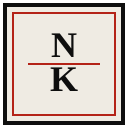

<div align="center">


<br>



<br>

<sub>ARSIP LEKSIKOGRAFI DIGITAL · EDISI 001</sub>

# N3KR0L0G1

**Kata-kata yang pergi, tidak harus hilang.**

Lembaran memorial digital untuk kosakata Indonesia yang perlahan tersisih dari percakapan sehari-hari. Dibungkus dalam rupa koran *broadsheet*, dengan tipografi kinetik dan arsip yang bisa dijelajahi.

<a href="#mimbar-obituari"></a>
<a href="#arsip-kata"></a>
<a href="#ruang-produksi"></a>
<a href="#cara-membuka-lembaran"></a>

</div>

---

<div align="center">

<br><sub>CATATAN REDAKSI · 01</sub>
</div>

## Sebelum lembaran dibuka

Beberapa kata tidak benar-benar mati. Kita hanya berhenti memanggilnya.

N3KR0L0G1 berangkat dari ide sederhana: kata-kata lama juga layak punya tempat untuk dikenang. Awalnya project ini dibuat untuk kebutuhan pribadi. Dari situ, bentuknya berkembang menjadi arsip memorial dengan bahasa visual surat kabar cetak, kolom editorial, dan tipografi yang bergerak.

Ini bukan kamus yang berusaha memuat semuanya. Ini sebuah lembaran kecil untuk menengok kata-kata yang mulai jarang terdengar.

<div align="center">


</div>

---

<div align="center">

<br><sub>LEMBARAN VISUAL · 02</sub>
</div>

## Sekilas dari arsip

<!-- Saat GIF asli tersedia, aktifkan baris berikut. -->
<!-- <p align="center"></p> -->

<div align="center">

| EDISI PAGI | EDISI MALAM |
|:---:|:---:|
|  |  |

<sub>Placeholder konsep warna, bukan screenshot website.</sub>

</div>

---

<div align="center">

<br><sub>MIMBAR UTAMA · 03</sub>
</div>

## Fitur yang bisa dijelajahi

### 01 — Judul yang tidak diam

`N3KR0L0G1` memakai tipografi variabel Roboto Flex. Pointer dan mistar 12 segmen mengubah karakter judul secara interaktif. Saat halaman dibuka, huruf hadir lewat animasi masuk bertahap.

### 02 — Mimbar obituari

Satu lema mendapat panggung utama. Pindah antar kata melalui tombol sebelumnya/berikutnya, mistar kemajuan, tombol panah keyboard, atau kartu katalog. Lema aktif disinkronkan dengan hash URL dan diumumkan melalui `aria-live`.

### 03 — Dua edisi, satu arsip

<div align="center">


</div>

- **Edisi Pagi** memakai warna kertas hangat `#EFEBE3` dan tinta arang `#0E0E0E`.
- **Edisi Malam** memakai latar arang `#161614` dan tinta krem `#F4F0EA`.
- Pilihan edisi disimpan di `localStorage`, tanpa cookie pihak ketiga.

### 04 — Katalog 15 lema

<div align="center">

<br><sub>ARSIP KATA · 15 ENTRI</sub>
</div>

`tetiron` · `djelata` · `cendayam` · `swatantra` · `puspas`  
`geramang` · `adicita` · `anggana` · `wiyata` · `renjana`  
`anala` · `sawala` · `gencat` · `candala` · `mansor`

Katalog dapat disaring berdasarkan dekade 1970-an hingga 2010-an. Tombol obituari acak memilih lema, membuka kartunya, lalu menggulir halaman ke posisinya. Kartu memakai `<details>` dan `<summary>` native agar konten tetap dapat dibuka tanpa JavaScript.

> **Catatan leksikografi**  
> “Kata yang berpulang” adalah framing editorial project ini. Status, makna, ejaan, dan riwayat penggunaan tiap lema tetap perlu dirujuk ke sumber yang bisa diverifikasi.

### 05 — Spesimen tipografi

<div align="center">


</div>

Tiga keluarga font lokal membentuk suara visual arsip ini.

| Font | Peran |
|---|---|
| **Fraunces** | Nuansa serif editorial |
| **Roboto Flex** | Judul kinetik dan tipografi fleksibel |
| **Recursive** | Detail teknis dan karakter mesin tik |

Font disimpan dalam format WOFF2 di folder `fonts/`, bukan dimuat dari Google Fonts CDN.

### 06 — Detail kecil yang disengaja

- Logo `[NK]` memuat ulang halaman dan mengembalikan posisi ke puncak.
- Preferensi `prefers-reduced-motion` menjadi bagian dari pertimbangan gerak.
- Komentar kode mengikuti aturan internal project untuk tidak memakai tanda kurung.
- Aset ikon dan font disimpan lokal.

---

<div align="center">

<br><sub>RUANG PRODUKSI · 04</sub>
</div>

## Di balik halaman

<div align="center">

<br><sub>HTML SEMANTIK · CSS TERSTRUKTUR · VANILLA JAVASCRIPT</sub>
</div>

Tidak ada framework, Bootstrap, npm, atau backend runtime. Isi lema disimpan sebagai data di `js/data.js`; tampilan dan interaksi dipisahkan ke berkas masing-masing.

```text
NEKROLOGI/
├── index.html
├── favicon.svg
├── css/
│   ├── tokens.css
│   ├── layout.css
│   └── components.css
├── js/
│   ├── data.js
│   ├── render.js
│   └── main.js
├── fonts/
├── icons/
├── docs/
│   └── NEKROLOGI.md
└── _headers
```

`_headers` disertakan untuk konfigurasi header pada hosting yang mendukung format tersebut. Sesuaikan jika memakai platform lain.

---

<div align="center">

<br><sub>CARA MEMBUKA LEMBARAN · 05</sub>
</div>

## Cara membuka lembaran

Tak perlu `npm install`. Cukup klona repo, lalu buka `index.html` di browser.

```bash
git clone https://github.com/[USERNAME]/NEKROLOGI.git
cd NEKROLOGI
```

Buka `index.html` dengan klik dua kali. Jika ingin memakai server lokal:

```bash
python -m http.server 8000
```

Lalu kunjungi `http://localhost:8000`.

Ganti `[USERNAME]` dengan username GitHub yang benar sebelum menjalankan perintah klona.

---

<div align="center">

<br><sub>SUMBER & CATATAN · 06</sub>
</div>

## Sumber leksikografi

Beberapa titik awal untuk menelusuri kata dan konteks sejarahnya:

- [KBBI Daring](https://kbbi.kemdikbud.go.id/)
- [Badan Pengembangan dan Pembinaan Bahasa](https://badanbahasa.kemdikbud.go.id/)
- [Arsip Poedjangga Baroe](https://www.google.com/search?q=arsip+majalah+Poedjangga+Baroe+1933+1942)
- [Perpustakaan Nasional Republik Indonesia](https://www.perpusnas.go.id/)

Daftar ini adalah rujukan awal, bukan pernyataan bahwa setiap lema telah diverifikasi dari seluruh sumber tersebut. Untuk kutipan atau klaim historis tertentu, cantumkan sumber spesifik jika sudah diperiksa.

### Lisensi font

Fraunces, Roboto Flex, dan Recursive dikenal menggunakan SIL Open Font License. Periksa berkas lisensi yang menyertai aset yang benar-benar digunakan dan sertakan atribusi yang sesuai.

### Lisensi project

Lisensi source code project belum dinyatakan di README awal. Tambahkan jenis lisensi dan berkas `LICENSE` setelah diputuskan.

---

<div align="center">


<br>

**Ada kata yang tak lagi terdengar.  
Bukan berarti ia tak pernah berarti.**

<sub>N3KR0L0G1 · Arsip leksikografi digital</sub>

<br>

<sub>Dirawat dengan rasa ingin tahu, bukan klaim bahwa semua kata telah mati.</sub>

</div>
